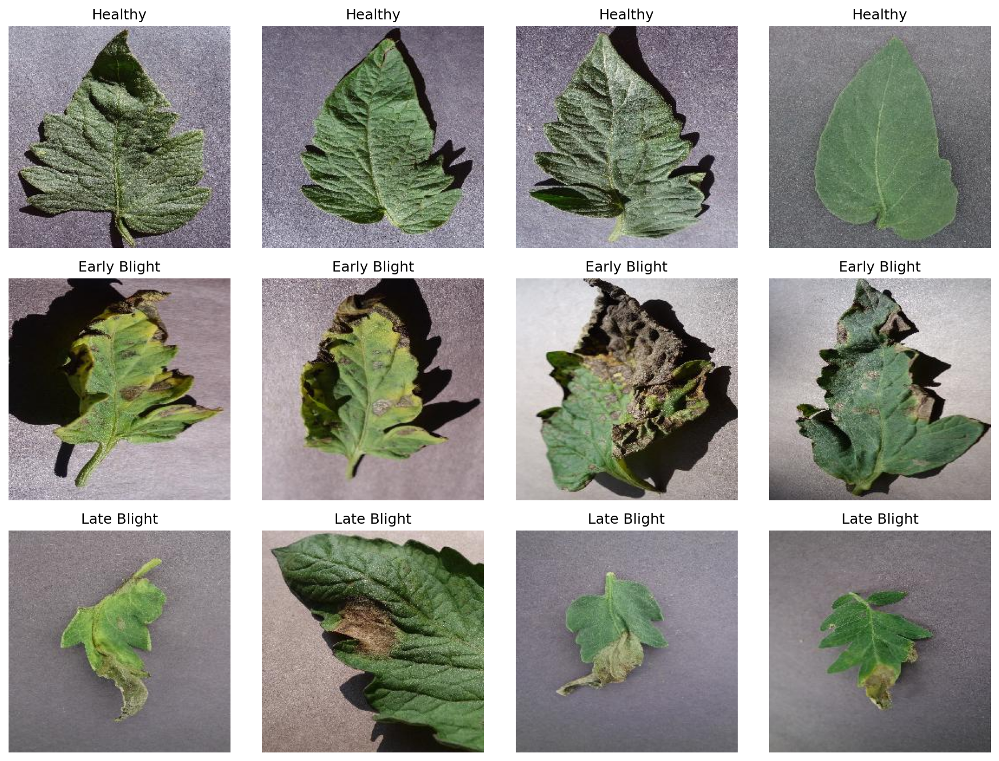
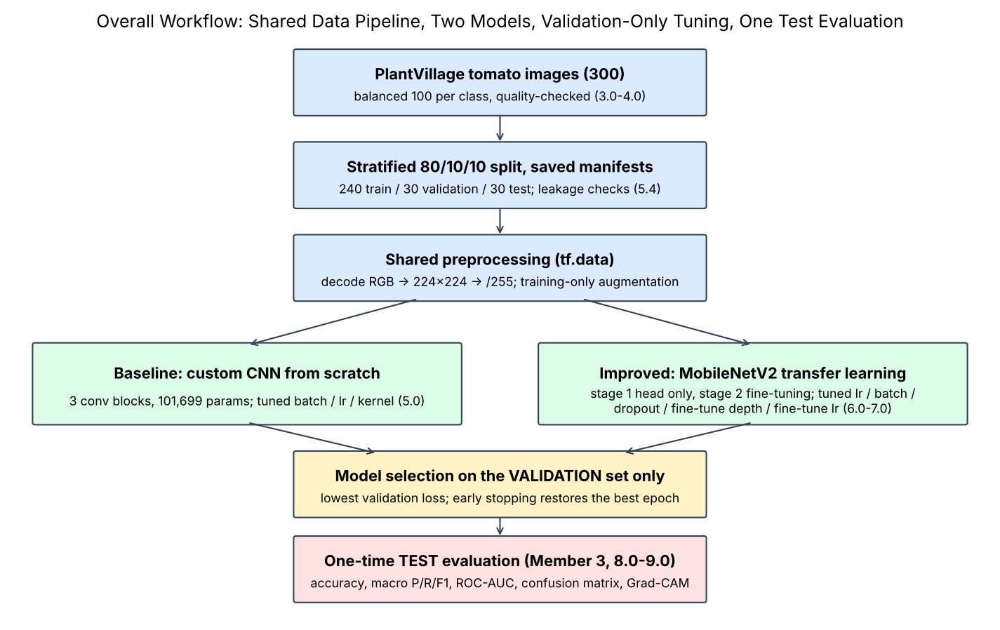
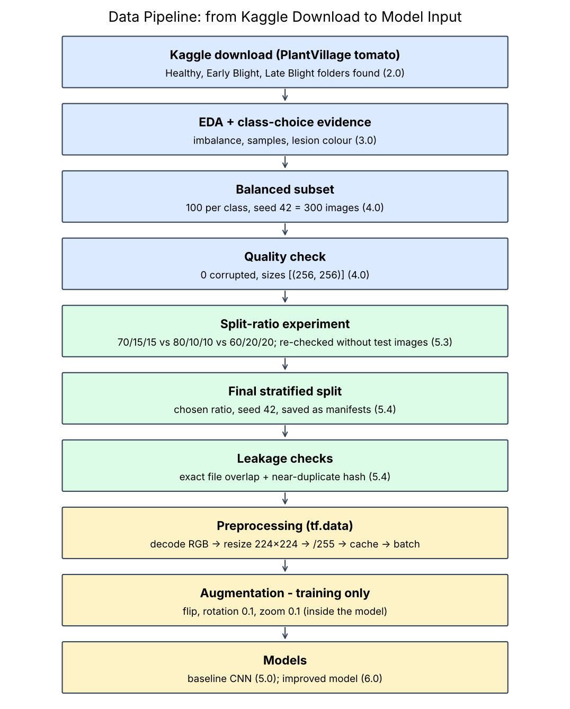
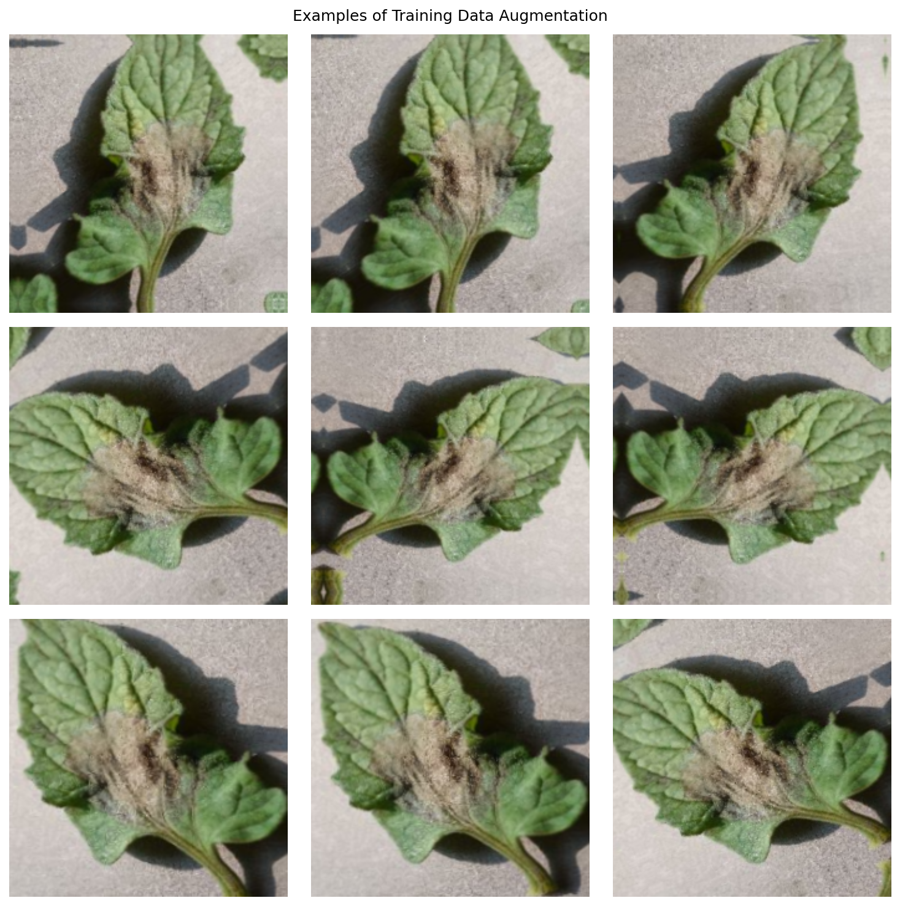
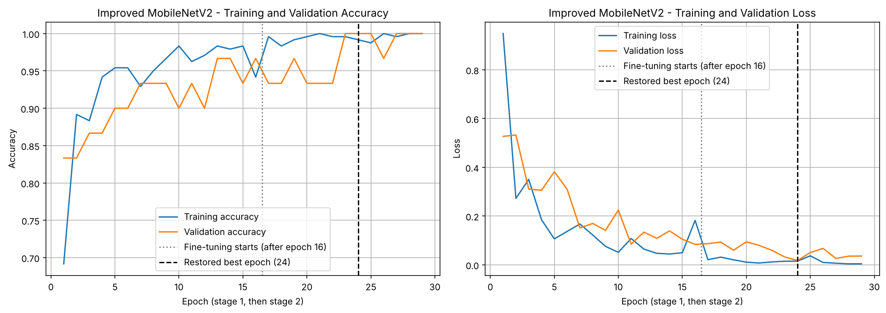

<a id="readme-top"></a>

<div align="center">



<h1>Tomato Leaf Disease Classification</h1>

<p><b>Tells Healthy, Early Blight and Late Blight tomato leaves apart. A small custom CNN is compared with a MobileNetV2 transfer-learning model, on a fixed, leakage-checked split that anyone can reproduce.</b></p>

<p>
  <a href="https://colab.research.google.com/github/Eman-271/IT8414-Tomato-Leaf-Disease-Classification/blob/main/notebook/IT8414_Tomato_Leaf_Classification_with_Member2.ipynb"></a>
  
  
  
  
  
  
  
  
  
</p>

<p>
  <b>IT8414 Deep Learning for Data Analytics</b> · Assessment 2, Group Project · Group 01
</p>

<p>
  <a href="#getting-started">Get started</a> ·
  <a href="#results">Results</a> ·
  <a href="documentation/DATA.md">Dataset documentation</a>
</p>

</div>

---

<details open>
<summary><b>Table of contents</b></summary>

1. [Project overview](#project-overview)
   - [Key features](#key-features)
   - [Pipeline at a glance](#pipeline-at-a-glance)
2. [Project structure](#project-structure)
3. [Tech stack](#tech-stack)
4. [Getting started](#getting-started)
   - [Prerequisites](#prerequisites)
   - [Option A: Google Colab (one click)](#option-a-google-colab-one-click)
   - [Option B: Local or offline (Jupyter)](#option-b-local-or-offline-jupyter)
   - [Configuration](#configuration)
   - [Rebuild the dataset from Kaggle (optional)](#rebuild-the-dataset-from-kaggle-optional)
5. [Usage and demo](#usage-and-demo)
6. [Results](#results)
7. [Reproducibility](#reproducibility)
8. [Contributors](#contributors)
9. [License and acknowledgements](#license-and-acknowledgements)

</details>

---

## Project overview

Early Blight and Late Blight are two common fungal-type diseases of tomato. Their brown, necrotic lesions look alike, and a leaf with Late Blight that is mistaken for a healthy one goes untreated. This project builds and compares two image classifiers for three classes:

| Class | Kaggle folder | Images in the download | Images used |
|---|---|---:|---:|
| Healthy | `Tomato___healthy` | 1,273 | 100 |
| Early Blight | `Tomato___Early_blight` | 800 | 100 |
| Late Blight | `Tomato___Late_blight` | 1,527 | 100 |

The work runs in three stages, each owned by one team member and each mapped to sections of one master notebook:

1. **Data and baseline (sections 1.0 – 5.9).** Load and check the images, run EDA, draw a balanced 300-image subset, choose the split ratio by experiment, then train and tune a custom CNN baseline and evaluate it once on the test set.
2. **Improved model (sections 6.0 – 7.7).** Two-stage transfer learning with MobileNetV2 (head-only tuning, then fine-tuning), with an ablation that shows the regularisation helps.
3. **Evaluation and interpretability (sections 8.0 – 10.0).** A test-set comparison of both models, error analysis and Grad-CAM. *In progress.*

### Key features

- **One official split for every model.** It is a stratified 80/10/10 split (240 / 30 / 30 images, seed 42), saved as CSV manifests in `data/split_manifests/`. Cell 1.0 checks the manifests' MD5 checksums and refuses to make a new split silently.
- **Split ratio chosen by experiment.** 70/15/15, 80/10/10 and 60/20/20 were each tried on three seeds, and 80/10/10 had the lowest mean validation loss. A second check, on the 270 images outside the final test set, picks the same ratio (`results/split_ratio_check_without_test.csv`).
- **Leakage checks.** No exact-file or near-duplicate overlap across train, validation and test (a 64-bit difference hash, Hamming distance ≤ 5).
- **One-factor-at-a-time tuning on validation loss only.** There are 6 baseline experiments (batch size, learning rate, kernel size) and 10 MobileNetV2 experiments (learning rate, batch size, dropout, fine-tune depth, fine-tune learning rate).
- **Overfitting control, measured.** Augmentation (flip, rotation ±10 %, zoom ±10 %), dropout and early stopping with best-weight restore. An ablation without them shows a 0.1155 train/validation loss gap, against 0.0025 with them.
- **Exact re-runs.** `M1_REUSE_SAVED` replays the saved baseline runs when settings match and retrains when they change. The trained models are committed, so a "Run all" reproduces the reported numbers.
- **No uploads needed in Colab.** The notebook clones this repository, including the dataset ZIP, the manifests and the trained models, into `/content/IT8414_Tomato_Project`.
- **Live demo cell.** Cell 5.8 predicts the class of a single new image.

### Pipeline at a glance

<div align="center">

</div>

<p align="right">(<a href="#readme-top">back to top</a>)</p>

---

## Project structure

```text
IT8414-Tomato-Leaf-Disease-Classification/
├── README.md
├── requirements.txt                 # pinned versions from the Colab run (Cell 1.0)
├── .gitignore                       # ignores *.zip except data/original/tomato_original.zip
│
├── notebook/
│   ├── IT8414_Tomato_Leaf_Classification_with_Member2.ipynb  # MASTER notebook: sections 1.0 – 7.7 (+ 8.0 – 10.0 placeholders)
│   ├── IT8414_Tomato_Leaf_Classification.ipynb               # Member 1 only: sections 1.0 – 5.9
│   └── IT8414_Member2_Sections_6_7.ipynb                     # Member 2 only: sections 6.0 – 7.7 (runs standalone)
│
├── scripts/
│   └── prepare_data.py              # rebuilds data/selected + split manifests without TensorFlow
│
├── data/
│   ├── original/
│   │   ├── README.md
│   │   └── tomato_original.zip      # the three Kaggle class folders, unmodified (59 MB)
│   ├── selected/                    # balanced subset: 100 images per class (seed 42)
│   │   ├── Tomato___Early_blight/
│   │   ├── Tomato___Late_blight/
│   │   └── Tomato___healthy/
│   └── split_manifests/             # THE official split used by every model
│       ├── train_split.csv          # 240 images (80 per class)
│       ├── validation_split.csv     #  30 images (10 per class)
│       ├── test_split.csv           #  30 images (10 per class)
│       └── data_summary.json        # counts, sizes, colour modes, leakage-check results
│
├── results/
│   ├── baseline_cnn_final.keras             # final baseline CNN (101,699 parameters)
│   ├── baseline_runs.json                   # baseline tuning runs, replayed by M1_REUSE_SAVED
│   ├── baseline_hyperparameter_results.csv
│   ├── baseline_test_results.json           # one-time test evaluation of the baseline
│   ├── improved_mobilenetv2_final.keras     # final MobileNetV2 model, Exp. I8 (21 MB)
│   ├── improved_stage1_selected.weights.h5  # stage-1 selected weights, Exp. I3
│   ├── improved_runs.json                   # MobileNetV2 tuning runs, used by M2_REUSE_SAVED
│   ├── improved_hyperparameter_results.csv
│   ├── improved_layer_table.csv
│   ├── improved_overfitting_ablation.csv
│   ├── improved_validation_results.json
│   ├── split_ratio_comparison.csv           # split-ratio experiment (Cell 5.3)
│   ├── split_ratio_check_without_test.csv   # same experiment without the final test images
│   ├── class_choice_evidence.json           # colour evidence for the class choice (Cell 3.0)
│   ├── NUMBERS_FOR_REPORT.txt               # every baseline number quoted in the report
│   ├── M2_NUMBERS_FOR_REPORT.txt            # every MobileNetV2 number quoted in the report
│   ├── README.md                            # which cell writes which file
│   └── figures/                             # report figures 3.1 – 3.6, 4.1, 5.1 – 5.4, D.1, D.2
│
└── documentation/
    └── DATA.md                      # dataset source, licence, structure and preparation
```

<p align="right">(<a href="#readme-top">back to top</a>)</p>

---

## Tech stack

This is a notebook-based deep-learning project, so it has no web frontend, backend server or database. Data lives in image folders and CSV manifests, and results are saved as JSON, CSV and `.keras` files.

| Category | Technology | Used for |
|---|---|---|
| Language | Python 3.13 | Everything |
| Deep learning | TensorFlow 2.21.0, Keras 3.13.2 | `tf.data` pipelines, custom CNN, MobileNetV2 (ImageNet weights), callbacks |
| Data handling | NumPy 2.4.6, pandas 2.2.3, Pillow | Arrays, manifests, image checks and hashing |
| Evaluation | scikit-learn 1.6.1 | Stratified splits, classification report, confusion matrix, ROC-AUC |
| Visualisation | Matplotlib | Learning curves, EDA plots, confusion matrices |
| Environment | Google Colab (T4 GPU), Jupyter | Running the notebooks |
| Data source | Kaggle, *plantvillage Tomato leaf dataset* | Original images (also committed as `data/original/tomato_original.zip`) |
| Optional | `kagglehub` | Alternative Kaggle download path in Cell 1.0 (preinstalled in Colab) |
| Version control | Git, GitHub | Code, data, models and history |

<p align="right">(<a href="#readme-top">back to top</a>)</p>

---

## Getting started

### Prerequisites

- A Google account for Colab, **or** Python 3.13 with `pip` and Git for a local run
- About 1 GB of free disk space, because the repository holds the dataset ZIP and both trained models
- A GPU is optional. Everything also runs on CPU: the full MobileNetV2 tuning took about 11 minutes there.

### Option A: Google Colab (one click)

1. Click **Open in Colab** at the top of this page.
2. Choose **Runtime → Change runtime type → T4 GPU**.
3. Choose **Runtime → Run all**.

Nothing needs to be uploaded. Cell 1.0 checks `/content/IT8414_Tomato_Project` against the official manifests' MD5 checksums. If the folder is missing or holds a different split, the cell moves it aside (`…_old_<timestamp>`) and clones this repository there.

### Option B: Local or offline (Jupyter)

```bash
# 1. Clone
git clone https://github.com/Eman-271/IT8414-Tomato-Leaf-Disease-Classification.git
cd IT8414-Tomato-Leaf-Disease-Classification

# 2. Create an environment and install the pinned dependencies
python -m venv .venv
source .venv/bin/activate          # Windows: .venv\Scripts\activate
pip install -r requirements.txt
pip install notebook               # Jupyter is not in requirements.txt (Colab ships it)

# 3. Open the master notebook and run all cells
cd notebook
jupyter notebook IT8414_Tomato_Leaf_Classification_with_Member2.ipynb
```

Outside Colab, the notebook uses the folder above `notebook/` as the project folder, so no further configuration is needed. It never tries to upload or download anything in this mode.

### Configuration

There is no `.env` file. The notebooks read two optional environment variables:

| Variable | Default | Effect |
|---|---|---|
| `IT8414_PROJECT_DIR` | the folder above `notebook/` (local), or `/content/IT8414_Tomato_Project` (Colab) | Project root that holds `data/` and `results/` |
| `IT8414_REPO_BRANCH` | `main` | Branch that Cell 1.0 clones in Colab |

```bash
# macOS / Linux
export IT8414_PROJECT_DIR="$HOME/IT8414-Tomato-Leaf-Disease-Classification"
# Windows (cmd)
set IT8414_PROJECT_DIR=C:\path\to\IT8414-Tomato-Leaf-Disease-Classification
```

```python
# Colab: test a branch before it is merged (run before Cell 1.0)
import os
os.environ["IT8414_REPO_BRANCH"] = "my-branch"
```

These switches live inside the notebook:

| Flag | Cell | Default | Effect |
|---|---|---|---|
| `M1_REUSE_SAVED` | 5.2 | `True` | Replays a baseline run from `results/baseline_runs.json` only when its settings and images match exactly. A changed setting, such as a new learning rate, is trained live. `False` retrains everything. |
| `M2_REUSE_SAVED` | 6.2 | `False` | `True` loads the MobileNetV2 runs from `results/improved_runs.json` and the final model. It does not check settings, so keep it `False` when you change a hyperparameter. |
| `DOWNLOAD_MEMBER1_RESULTS` | 5.9 | `False` | `True` downloads Member 1's results as a ZIP (Colab only) |

### Rebuild the dataset from Kaggle (optional)

The repository already contains the 300-image subset and the split, so this step is only needed to show where they come from. `prepare_data.py` repeats notebook cells 2.0 – 4.0 with the same seed and needs no TensorFlow.

```bash
# Put the three Kaggle class folders into data/original/ (or unzip the committed ZIP)
unzip data/original/tomato_original.zip -d data/original/

python scripts/prepare_data.py                    # same seed → same 300 images and split
python scripts/prepare_data.py --rebuild          # recreate data/selected from scratch
python scripts/prepare_data.py --ratio 70/15/15   # try another ratio (the official one is 80/10/10)
```

| Argument | Default | Meaning |
|---|---|---|
| `--project` | `.` | Project root |
| `--original` | `<project>/data/original` | Folder that holds the three class folders |
| `--rebuild` | off | Delete and redraw `data/selected` |
| `--ratio` | `80/10/10` | Train/validation/test ratio |

<p align="right">(<a href="#readme-top">back to top</a>)</p>

---

## Usage and demo

### Notebook map

| Sections | Owner | What happens |
|---|---|---|
| 1.0 | All | Environment, versions, project folder, split check (MD5) |
| 2.0 – 3.0 | Member 1 | Load and verify images, EDA, evidence for the class choice |
| 4.0 | Member 1 | Preprocessing (resize to 224 × 224, scale to 0–1), augmentation, `tf.data` pipeline |
| 5.1 – 5.4 | Member 1 | Baseline architecture, split-ratio experiment, final split and leakage checks |
| 5.5 – 5.9 | Member 1 | Six tuning experiments, final baseline, one-time test evaluation, single-image prediction |
| 6.0 – 6.2 | Member 2 | Data check, MobileNetV2 architecture and training helper |
| 7.1 – 7.7 | Member 2 | Stage 1 (I1–I7), stage 2 fine-tuning (I8–I10), selection, ablation, final model, Grad-CAM hook |
| 8.0 – 10.0 | Member 3 | Test-set comparison, interpretability, conclusion *(in progress)* |

### Use a trained model in your own code

```python
import tensorflow as tf

CLASS_NAMES = ["Healthy", "Early Blight", "Late Blight"]   # label_id 0, 1, 2 in the manifests

model = tf.keras.models.load_model("results/improved_mobilenetv2_final.keras")
# or: tf.keras.models.load_model("results/baseline_cnn_final.keras")

img = tf.keras.utils.load_img("path/to/leaf.jpg", target_size=(224, 224))
x = tf.keras.utils.img_to_array(img)[None, ...] / 255.0   # both models expect 0–1 input
probs = model.predict(x, verbose=0)[0]
print(CLASS_NAMES[probs.argmax()], f"{probs.max():.1%}")
```

The MobileNetV2 model rescales its 0–1 input to −1…1 internally, so both models take the same preprocessing.

### Live modification example

Change one hyperparameter and re-run from that cell. With `M1_REUSE_SAVED = True`, only the changed run is retrained:

```python
# Cell 5.5: change an experiment's value, for example Experiment 4's learning rate
result, run_history, run_model = run_experiment(4, "Learning rate", "0.0005", learning_rate=0.0005)
```

### Preview

| Data pipeline (Figure 3.4) | Augmentation (Figure 3.5) |
|---|---|
|  |  |

| MobileNetV2 learning curves (Figure 5.2) | Baseline confusion matrix (Figure 5.4) |
|---|---|
|  |  |

<!-- Placeholder: add a screenshot of the notebook running in Colab here, e.g.
 -->

> **Screenshot placeholder:** a Colab "Run all" screenshot and the Grad-CAM figures from Member 3 (section 9.0) will go here.

<p align="right">(<a href="#readme-top">back to top</a>)</p>

---

## Results

All model selection used the **validation set only**. The test set (30 images) is used once.

### Validation comparison

| Model | Validation accuracy | Validation loss | Parameters |
|---|---:|---:|---:|
| Baseline CNN (Exp. 2: batch 8, lr 0.001, 3×3 kernels) | 90.00 % | 0.3779 | 101,699 |
| MobileNetV2 (Exp. I8: fine-tuned from block 14, lr 1e-5) | **100.00 %** | **0.0176** | 2,261,827 (1,514,563 trainable) |

### Baseline test result (Member 1)

| Accuracy (95 % CI) | Macro F1 (95 % CI) | Macro ROC-AUC | Recall: Healthy / Early / Late |
|---|---|---:|---|
| 80.00 % (66.67 – 93.33 %) | 79.38 % (62.49 – 91.68 %) | 0.8950 | 100 % / 80 % / 60 % |

The test-set comparison of both models is in section 8.0 (Member 3). With 30 test images, one image equals 3.3 percentage points, so small differences between models may be noise.

### Overfitting-control ablation (MobileNetV2)

| Setting | Train loss | Val loss | Gap | Val accuracy |
|---|---:|---:|---:|---:|
| Augmentation + dropout + early stopping (final) | 0.0151 | 0.0176 | 0.0025 | 100.00 % |
| None of the three (70 epochs) | 0.0000 | 0.1155 | 0.1155 | 96.67 % |

Full tables: `results/NUMBERS_FOR_REPORT.txt` and `results/M2_NUMBERS_FOR_REPORT.txt`.

<p align="right">(<a href="#readme-top">back to top</a>)</p>

---

## Reproducibility

- **One seed (42)** for sampling, splitting, shuffling, augmentation and weight initialisation. `tf.keras.utils.set_random_seed` is reset before every model is built.
- **The split is saved once** as CSV manifests (`filename, label, label_id, split, relative_path`), and every model loads the same files.
- **The split is verified, not trusted.** Cell 1.0 checks the manifests' MD5 checksums, and Cell 6.0 stops the run if the split is not 240 / 30 / 30.
- **Pinned versions** are in `requirements.txt`. The baseline runs used a Colab T4 GPU; the MobileNetV2 numbers in `M2_NUMBERS_FOR_REPORT.txt` come from a CPU run. Retraining on different hardware can move the last decimals.

<p align="right">(<a href="#readme-top">back to top</a>)</p>

---

## Contributors

| Member | Role | Notebook sections | Report sections |
|---|---|---|---|
| **Fatema** (Member 1) | Data pipeline, EDA, split, baseline CNN, `DATA.md` | 1.0 – 5.9 | 1, 3 |
| **Eman Khamdan** (Member 2) | Improved model (MobileNetV2), tuning, overfitting control, version control | 6.0 – 7.7 | 2, 4, 5.1 – 5.2 |
| **[Member 3 name]** (Member 3) | Test evaluation, error analysis, interpretability (Grad-CAM) | 8.0 – 10.0 | 5.3 – 5.5, 6, 7 |

Generative AI tools were used during development, as declared in the group's AI-use statement.

<p align="right">(<a href="#readme-top">back to top</a>)</p>

---

## License and acknowledgements

- **Dataset.** The images come from the PlantVillage dataset (Hughes & Salathé, 2015) and are distributed under the [Apache License 2.0](http://www.apache.org/licenses/LICENSE-2.0). The 300 images in `data/selected/` and the class folders in `data/original/tomato_original.zip` are unmodified copies, included under that licence with credit to the authors. See [`documentation/DATA.md`](documentation/DATA.md).
- **Code.** Written for IT8414 coursework. The repository has no separate licence file for the code yet.
- **Source.** [plantvillage Tomato leaf dataset on Kaggle](https://www.kaggle.com/datasets/charuchaudhry/plantvillage-tomato-leaf-dataset)
- **Model.** MobileNetV2 (Sandler et al., 2018), with ImageNet weights from `tf.keras.applications`
- **README layout.** Inspired by [Best-README-Template](https://github.com/othneildrew/Best-README-Template)

> Hughes, D. P., & Salathé, M. (2015). *An open access repository of images on plant health to enable the development of mobile disease diagnostics*. arXiv:1511.08060.
> Sandler, M., Howard, A., Zhu, M., Zhmoginov, A., & Chen, L.-C. (2018). MobileNetV2: Inverted residuals and linear bottlenecks. *CVPR*, 4510–4520.

<p align="right">(<a href="#readme-top">back to top</a>)</p>
