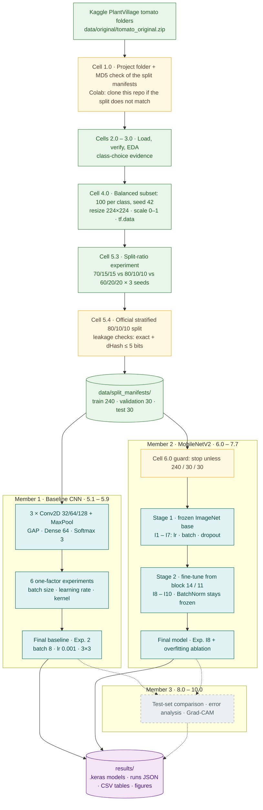
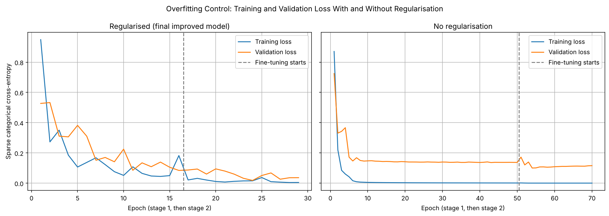
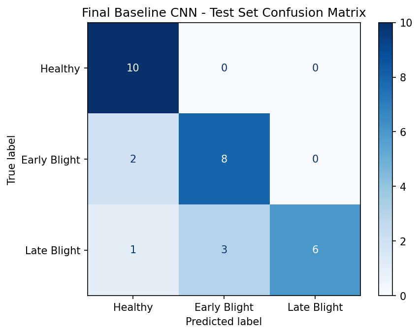
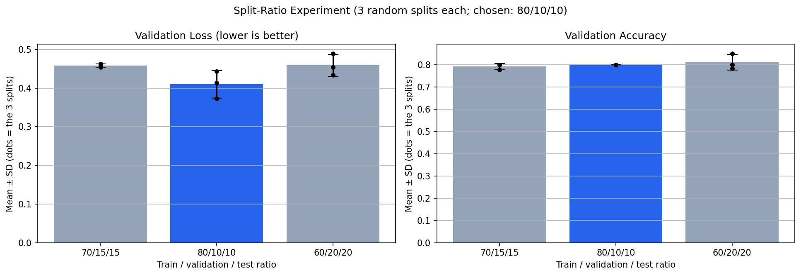

<a id="readme-top"></a>

<div align="center">


<a href="#overview"></a>

<br>

<a href="https://colab.research.google.com/github/Eman-271/IT8414-Tomato-Leaf-Disease-Classification/blob/main/notebook/IT8414_Tomato_Leaf_Classification_Final.ipynb"></a>


<br>


<br>


<br><br>

<b>
<a href="#overview">Overview</a> ·
<a href="#architecture">Architecture</a> ·
<a href="#features">Features</a> ·
<a href="#quick-start">Quick Start</a> ·
<a href="#results">Results</a> ·
<a href="#team">Team</a>
</b>

</div>

<br>

<h2 id="overview">🍅 Overview</h2>

> [!IMPORTANT]
> **The problem.** Early Blight and Late Blight both leave brown, necrotic lesions on tomato leaves. A Late Blight leaf that is mistaken for a healthy one goes untreated. This project trains and compares two classifiers for **Healthy**, **Early Blight** and **Late Blight** leaves: a **custom CNN baseline** (101,699 parameters) and a **MobileNetV2 transfer-learning model** (2.26 M parameters, fine-tuned in two stages).

<div align="center">

</div>

| Class | Kaggle folder | In the download | Used (balanced, seed 42) | Train / Val / Test |
|---|---|---:|---:|:---:|
| 🟢 Healthy | `Tomato___healthy` | 1,273 | 100 | 80 / 10 / 10 |
| 🟤 Early Blight | `Tomato___Early_blight` | 800 | 100 | 80 / 10 / 10 |
| 🟫 Late Blight | `Tomato___Late_blight` | 1,527 | 100 | 80 / 10 / 10 |

> [!NOTE]
> The repository contains everything a run needs: the original images (`data/original/tomato_original.zip`), the 300-image subset, the official split manifests and both trained models. **Nothing has to be downloaded or uploaded by hand.**

<p align="right"><a href="#readme-top">↑ back to top</a></p>

<h2 id="architecture">🧭 Architecture</h2>

The whole project is a single master notebook. Each section belongs to one team member, and every model reads the same saved split.



<details>
<summary><b>🔬 Model internals at a glance</b></summary>

<br>

| | Baseline CNN (`build_baseline_cnn`, Cell 5.1) | Improved model (`build_improved_model`, Cell 6.1) |
|---|---|---|
| Input | 224 × 224 × 3, values 0–1 | 224 × 224 × 3, values 0–1 |
| Augmentation (training only) | `RandomFlip("horizontal")`, `RandomRotation(0.1)`, `RandomZoom(0.1)` | same block (`make_augmentation()`) |
| Feature extractor | `conv1` 32 → `pool1` → `conv2` 64 → `pool2` → `conv3` 128 → `pool3` | `Rescaling(2, -1)` to −1…1 → `MobileNetV2(include_top=False, weights="imagenet")` |
| Head | `GlobalAveragePooling2D` → `Dense(64, relu)` → `Dense(3, softmax)` | `GlobalAveragePooling2D` → `Dropout` → `Dense(3, softmax)` |
| Parameters | 101,699 | 2,261,827 total · 3,843 trainable (stage 1) · 1,514,563 (from block 14) |
| Training | Adam · early stopping on `val_loss`, best weights restored | Stage 1 Adam lr 0.01 · Stage 2 Adam lr 1e-5 · early stopping, patience 5 |
| Grad-CAM layer | `conv3` | activation hook in Cell 7.6 |

</details>

<p align="right"><a href="#readme-top">↑ back to top</a></p>

<h2 id="features">✨ Features</h2>

<table>
<tr>
<td width="50%" valign="top">

### 🔒 One verified split
A stratified **80/10/10** split (240 / 30 / 30, seed 42), saved as CSV manifests. Cell 1.0 checks their **MD5 checksums**, and Cell 6.0 stops the run if the split is wrong. A new split is never made silently.

</td>
<td width="50%" valign="top">

### 📐 Split ratio chosen by experiment
Three ratios × three seeds. **80/10/10 had the lowest mean validation loss**, and a re-check on the 270 non-test images (`split_ratio_check_without_test.csv`) picks the same ratio.

</td>
</tr>
<tr>
<td valign="top">

### 🧪 Leakage checks
No exact-file overlap and **no near-duplicates** (64-bit difference hash, ≤ 5 bits apart) across train, validation and test. The results are stored in `data_summary.json`.

</td>
<td valign="top">

### 🎛️ Disciplined tuning
**16 one-factor-at-a-time experiments** (6 baseline, 10 MobileNetV2). Every model is selected on **validation loss only**, and the test set is used once.

</td>
</tr>
<tr>
<td valign="top">

### 🛡️ Measured overfitting control
Augmentation + dropout + early stopping cut the train/validation loss gap from **0.1155 to 0.0025** in a controlled ablation (`improved_overfitting_ablation.csv`).

</td>
<td valign="top">

### ♻️ Exact re-runs
`M1_REUSE_SAVED` replays saved runs when the settings match and retrains when they change. Both final models are committed as `.keras` files.

</td>
</tr>
<tr>
<td valign="top">

### ☁️ Zero-upload Colab
One click opens the master notebook. Cell 1.0 clones the repository, with data, manifests and models, into `/content/IT8414_Tomato_Project`.

</td>
<td valign="top">

### 🎯 Live single-image demo
Cell 5.8 predicts the class of a new leaf photo. Everything also runs **offline** on a laptop, on CPU.

</td>
</tr>
</table>

> [!TIP]
> To change one hyperparameter during a live demo, edit its cell and re-run from there. With `M1_REUSE_SAVED = True`, only the changed baseline run is retrained, and every other run is replayed from `results/baseline_runs.json`.

<p align="right"><a href="#readme-top">↑ back to top</a></p>

<h2 id="quick-start">🚀 Quick Start</h2>

### Option A · Google Colab (one click)

1. Click <a href="https://colab.research.google.com/github/Eman-271/IT8414-Tomato-Leaf-Disease-Classification/blob/main/notebook/IT8414_Tomato_Leaf_Classification_Final.ipynb"></a>
2. Choose <kbd>Runtime</kbd> → <kbd>Change runtime type</kbd> → <kbd>T4 GPU</kbd>.
3. Choose <kbd>Runtime</kbd> → <kbd>Run all</kbd>, or press <kbd>Ctrl</kbd> + <kbd>F9</kbd>.

If `/content/IT8414_Tomato_Project` is missing, or holds a split that does not match the official MD5 checksums, Cell 1.0 moves it aside (`…_old_<timestamp>`) and clones this repository there.

### Option B · Local or offline (Jupyter)

```bash
git clone https://github.com/Eman-271/IT8414-Tomato-Leaf-Disease-Classification.git
cd IT8414-Tomato-Leaf-Disease-Classification

python -m venv .venv
source .venv/bin/activate            # Windows: .venv\Scripts\activate
pip install -r requirements.txt
pip install notebook                 # Jupyter is not pinned in requirements.txt (Colab ships it)

cd notebook
jupyter notebook IT8414_Tomato_Leaf_Classification_Final.ipynb
```

Then choose <kbd>Kernel</kbd> → <kbd>Restart & Run All</kbd>. Outside Colab, the notebook uses the folder above `notebook/` as the project root and never uploads or downloads anything.

### Use a trained model

```python
import tensorflow as tf

CLASS_NAMES = ["Healthy", "Early Blight", "Late Blight"]        # label_id 0, 1, 2

model = tf.keras.models.load_model("results/improved_mobilenetv2_final.keras")
# or: tf.keras.models.load_model("results/baseline_cnn_final.keras")

img = tf.keras.utils.load_img("path/to/leaf.jpg", target_size=(224, 224))
x = tf.keras.utils.img_to_array(img)[None, ...] / 255.0        # both models take 0–1 input
probs = model.predict(x, verbose=0)[0]
print(CLASS_NAMES[probs.argmax()], f"{probs.max():.1%}")
```

### Rebuild the dataset from the original images (optional)

```bash
unzip data/original/tomato_original.zip -d data/original/
python scripts/prepare_data.py                     # same seed → same 300 images and split
python scripts/prepare_data.py --rebuild           # redraw data/selected from scratch
python scripts/prepare_data.py --ratio 70/15/15    # try another ratio (official: 80/10/10)
```

`prepare_data.py` repeats notebook cells 2.0 – 4.0 and needs only NumPy, pandas, Pillow and scikit-learn. It also accepts `--project <root>` and `--original <folder>`.

<details>
<summary><b>📁 Full repository directory tree</b></summary>

<br>

```text
IT8414-Tomato-Leaf-Disease-Classification/
├── README.md
├── requirements.txt                 # pinned versions from the Colab run (Cell 1.0)
├── .gitignore                       # ignores *.zip except data/original/tomato_original.zip
│
├── notebook/
│   ├── IT8414_Tomato_Leaf_Classification_Final.ipynb         # FINAL: 1.0 – 10.0, all members (submit this)
│   ├── IT8414_Tomato_Leaf_Classification_with_Member2.ipynb  # earlier master: 1.0 – 7.7
│   ├── IT8414_Tomato_Leaf_Classification.ipynb               # Member 1 only: 1.0 – 5.9
│   └── IT8414_Member2_Sections_6_7.ipynb                     # Member 2 only: 6.0 – 7.7 (standalone)
│
├── scripts/
│   └── prepare_data.py              # rebuilds data/selected + manifests (no TensorFlow)
│
├── data/
│   ├── original/
│   │   ├── README.md
│   │   └── tomato_original.zip      # the three Kaggle class folders, unmodified (59 MB)
│   ├── selected/                    # 100 images per class
│   │   ├── Tomato___Early_blight/
│   │   ├── Tomato___Late_blight/
│   │   └── Tomato___healthy/
│   └── split_manifests/
│       ├── train_split.csv          # 240 images (80 per class)
│       ├── validation_split.csv     #  30 images (10 per class)
│       ├── test_split.csv           #  30 images (10 per class)
│       └── data_summary.json        # counts, sizes, colour modes, leakage checks
│
├── results/
│   ├── baseline_cnn_final.keras             # final baseline CNN (1.3 MB)
│   ├── baseline_runs.json                   # baseline runs, replayed by M1_REUSE_SAVED
│   ├── baseline_hyperparameter_results.csv
│   ├── baseline_test_results.json           # one-time baseline test evaluation
│   ├── improved_mobilenetv2_final.keras     # final MobileNetV2, Exp. I8 (21 MB)
│   ├── improved_stage1_selected.weights.h5  # stage-1 selected weights, Exp. I3
│   ├── improved_runs.json                   # MobileNetV2 runs, used by M2_REUSE_SAVED
│   ├── improved_hyperparameter_results.csv
│   ├── improved_layer_table.csv
│   ├── improved_overfitting_ablation.csv
│   ├── improved_validation_results.json
│   ├── split_ratio_comparison.csv
│   ├── split_ratio_check_without_test.csv
│   ├── class_choice_evidence.json
│   ├── NUMBERS_FOR_REPORT.txt               # every baseline number in the report
│   ├── M2_NUMBERS_FOR_REPORT.txt            # every MobileNetV2 number in the report
│   ├── README.md                            # which cell writes which file
│   └── figures/                             # figures 3.1 – 3.6, 4.1, 5.1 – 5.4, D.1, D.2
│
└── documentation/
    └── DATA.md                      # dataset source, licence, structure, preparation
```

</details>

<details>
<summary><b>⚙️ Environment variables and configuration guide</b></summary>

<br>

The project has **no `.env` file and needs no API keys**. The notebooks read two optional environment variables:

| Variable | Default | Effect |
|---|---|---|
| `IT8414_PROJECT_DIR` | the folder above `notebook/` (local), or `/content/IT8414_Tomato_Project` (Colab) | Project root that holds `data/` and `results/` |
| `IT8414_REPO_BRANCH` | `main` | Branch that Cell 1.0 clones in Colab |

```bash
# macOS / Linux
export IT8414_PROJECT_DIR="$HOME/IT8414-Tomato-Leaf-Disease-Classification"

# Windows (cmd)
set IT8414_PROJECT_DIR=C:\path\to\IT8414-Tomato-Leaf-Disease-Classification
```

```python
# Colab: test an unmerged branch (run before Cell 1.0)
import os
os.environ["IT8414_REPO_BRANCH"] = "my-branch"
```

These switches are set inside the notebook:

| Flag | Cell | Default | Effect |
|---|---|---|---|
| `M1_REUSE_SAVED` | 5.2 | `True` | Replays a baseline run from `results/baseline_runs.json` only if its settings and images match exactly. A changed setting is trained live. `False` retrains everything. |
| `M2_REUSE_SAVED` | 6.2 | `False` | `True` loads the MobileNetV2 runs and the final model from `results/`. It does not check settings, so keep it `False` when you change a hyperparameter. |
| `DOWNLOAD_MEMBER1_RESULTS` | 5.9 | `False` | `True` downloads Member 1's results as a ZIP (Colab only) |

Pinned versions (`requirements.txt`): `tensorflow==2.21.0`, `keras==3.15.1`, `numpy==2.4.6`, `pandas==2.2.3`, `scikit-learn==1.6.1`, plus `matplotlib` and `pillow`.

</details>

<details>
<summary><b>🗄️ Data schema: manifests and result files</b> (there is no database or web API)</summary>

<br>

The project has **no server, REST API or database**. Its "interfaces" are files that the notebook writes and reads.

**Split manifests:** `data/split_manifests/{train,validation,test}_split.csv`

| Column | Type | Example |
|---|---|---|
| `filename` | string | `65579d4a-…___RS_Erly.B 7475.JPG` |
| `label` | string | `Tomato___Early_blight` |
| `label_id` | int | `0` Healthy · `1` Early Blight · `2` Late Blight |
| `split` | string | `train` / `validation` / `test` |
| `relative_path` | string | `data/selected/Tomato___Early_blight/…JPG` |

**`data/split_manifests/data_summary.json`:** `dataset`, `class_folders`, `seed`, `original_counts`, `images_per_class`, `image_sizes`, `colour_modes`, `corrupted_images`, `split_ratio`, `split_ratio_comparison`, `split_sizes`, `split_class_counts`, `exact_overlap`, `near_duplicate_pairs`, `near_duplicate_threshold_bits`

**`results/improved_hyperparameter_results.csv`:** `Exp.`, `Parameter varied`, `Value`, `Epochs run`, `Best epoch`, `Train acc.`, `Val. acc.`, `Train loss`, `Val. loss`, `Params`, `Train time (min)`, `Stage`, `Trainable params`

**`results/improved_runs.json`:** one entry per experiment (`I1` … `I10`), with its settings, summary and epoch history

**`results/baseline_test_results.json`:** `selected_experiment`, `configuration`, `validation_accuracy`, `validation_loss`, `test_loss`, `test_accuracy`, `test_accuracy_95ci`, `macro_f1`, `macro_f1_95ci`, `macro_roc_auc`, `recall_per_class`, `confusion_matrix`, …

**Python entry points in the notebook**

| Function | Cell | Purpose |
|---|---|---|
| `make_augmentation()` | 4.0 | The shared augmentation block |
| `build_baseline_cnn(kernel_size)` | 5.1 | Builds the baseline CNN |
| `run_experiment(n, parameter, value, **settings)` | 5.2 | Trains (or replays) one baseline run; called in 5.5 |
| `build_improved_model(dropout_rate, augment)` | 6.1 | Builds the MobileNetV2 model |
| `set_fine_tuning(model, from_block)` | 6.1 | Unfreezes the base from `block_<n>_expand` |

</details>

<p align="right"><a href="#readme-top">↑ back to top</a></p>

<h2 id="results">📊 Results</h2>

> [!IMPORTANT]
> All model selection used the **validation set only**. The 30 test images are used once.

<table>
<tr>
<th>Model</th><th>Val accuracy</th><th>Val loss</th><th>Parameters</th>
</tr>
<tr>
<td>Baseline CNN · Exp. 2 (batch 8, lr 0.001, 3×3)</td><td align="right">90.00 %</td><td align="right">0.3779</td><td align="right">101,699</td>
</tr>
<tr>
<td><b>MobileNetV2 · Exp. I8 (fine-tuned from block 14, lr 1e-5)</b></td><td align="right"><b>100.00 %</b></td><td align="right"><b>0.0176</b></td><td align="right">2,261,827</td>
</tr>
</table>

**Baseline on the test set (Member 1):** 80.00 % accuracy (95 % CI 66.67 – 93.33 %), macro F1 79.38 %, macro ROC-AUC 0.8950. Recall is 100 % for Healthy, 80 % for Early Blight and 60 % for Late Blight. The test-set comparison of both models is in section 8.0 (Member 3):

| Model (test set, 30 images) | Accuracy | Macro F1 | Late Blight recall | Diseased → Healthy errors | Macro ROC-AUC |
|---|---|---|---|---|---|
| Baseline CNN | 80.00 % | 79.38 % | 60 % | 3 | 0.8950 |
| **MobileNetV2 (recommended)** | **83.33 %** | **83.13 %** | **90 %** | **1** | **0.9633** |

> [!NOTE]
> With 30 test images, one image is worth 3.3 percentage points, so small gaps between models may be noise. The full tables are in `results/NUMBERS_FOR_REPORT.txt` and `results/M2_NUMBERS_FOR_REPORT.txt`. The MobileNetV2 numbers come from a CPU run, so retraining on a GPU can move the last decimals.

<h3>🖼️ Preview showcase</h3>

<table>
<tr>
<td align="center" width="50%"><br><sub><b>Figure 4.1</b> · Overall workflow</sub></td>
<td align="center" width="50%"><br><sub><b>Figure 3.4</b> · Data pipeline</sub></td>
</tr>
<tr>
<td align="center"><br><sub><b>Figure 5.2</b> · MobileNetV2 learning curves</sub></td>
<td align="center"><br><sub><b>Figure 5.3</b> · Overfitting-control ablation</sub></td>
</tr>
<tr>
<td align="center"><br><sub><b>Figure 5.4</b> · Baseline confusion matrix (test)</sub></td>
<td align="center"><br><sub><b>Figure 3.6</b> · Split-ratio experiment</sub></td>
</tr>
<tr>
<td align="center" colspan="2">
<br>
<!-- Drop a demo GIF or screenshot here, for example:
 -->
<sub>🎬 <b>Placeholder:</b> Colab "Run all" demo GIF and Member 3's Grad-CAM figures (section 9.0)</sub>
<br><br>
</td>
</tr>
</table>

<p align="right"><a href="#readme-top">↑ back to top</a></p>

<h2 id="team">👥 Team</h2>

<table>
<tr>
<td align="center" width="33%" valign="top">
<h3>Fatema Alashiri</h3>
<sub><b>Member 1 · Data pipeline & baseline CNN</b></sub><br><br>
Data loading, EDA, balanced subset, split-ratio experiment, leakage checks, baseline CNN and its tuning, <code>DATA.md</code><br><br>
<code>Notebook 1.0 – 5.9</code> · <code>Report 1, 3</code>
</td>
<td align="center" width="33%" valign="top">
<h3>Eman Khamdan</h3>
<sub><b>Member 2 · Improved model & tuning</b></sub><br><br>
MobileNetV2 transfer learning, two-stage tuning, overfitting ablation, version control and the GitHub repository<br><br>
<code>Notebook 6.0 – 7.7</code> · <code>Report 2, 4, 5.1 – 5.2</code>
</td>
<td align="center" width="33%" valign="top">
<h3>Abrar Alawadhi</h3>
<sub><b>Member 3 · Evaluation & interpretability</b></sub><br><br>
Test-set comparison of both models, error analysis, Grad-CAM, conclusion and slides<br><br>
<code>Notebook 8.0 – 10.0</code> · <code>Report 5.3 – 5.5, 6, 7</code>
</td>
</tr>
</table>

<details>
<summary><b>📜 Licence, credits and references</b></summary>

<br>

- **Dataset.** The images come from the PlantVillage dataset (Hughes & Salathé, 2015) and are distributed under the [Apache License 2.0](http://www.apache.org/licenses/LICENSE-2.0). The images in `data/selected/` and `data/original/tomato_original.zip` are unmodified copies, included under that licence with credit to the authors. See [`documentation/DATA.md`](documentation/DATA.md).
- **Source.** [plantvillage Tomato leaf dataset on Kaggle](https://www.kaggle.com/datasets/charuchaudhry/plantvillage-tomato-leaf-dataset)
- **Model.** MobileNetV2 (Sandler et al., 2018), with ImageNet weights from `tf.keras.applications`
- **Code.** Written for IT8414 coursework. The repository has no separate licence file for the code.
- **Generative AI.** AI tools were used during development, as declared in the group's AI-use statement.

> Hughes, D. P., & Salathé, M. (2015). *An open access repository of images on plant health to enable the development of mobile disease diagnostics*. arXiv:1511.08060.
>
> Sandler, M., Howard, A., Zhu, M., Zhmoginov, A., & Chen, L.-C. (2018). MobileNetV2: Inverted residuals and linear bottlenecks. *Proceedings of CVPR*, 4510–4520.

</details>

<div align="center">

</div>
